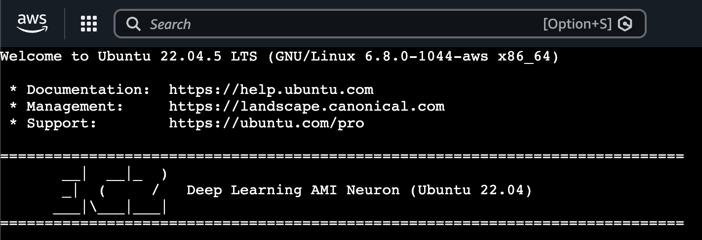

## A little bit of background
I've been curious about ML accelerators for a while but I've never really understood anything about them. Two weeks ago I was wandering in my natural habitat (AWS console) and the page flashed me with one of those tempting try-me ads from the login page. AWS has this habit of introducing random services to you here and there but this time it piqued my curiosity and I had one of those moments that "no really, what is this thing about".

Here we are a few days later and I have a few interesting things to share. In this post we are talking about the philosophy of their existence, they current options in the market and how to actually run a normal LLM model in one of them. This post is more dedicated to an audience of DevOps/MLOps background so we stay the hell away from notebooks and keep our heads down in the terminal... where they belong!

### What is an ML accelerator really?

In simple terms, anything (of silicon) that speeds up machine learning operations is an accelerator of some sense. GPUs are the first of their kind, but they are not what we are talking about today. GPUs were built in the late 90s for processing pixels. No one in early 2000s bought GPUs for arithmetic, it was practically not possible. NVIDIA saw the opportunity and created CUDA library in 2006 to provide general math as an extra functionality of GPUs. All the popular ML libraries of today like pytorch, jax or tensorflow use CUDA as a backend.

Google projected in early 2010 that its workload for AI doubles every 18 months, so they invested in a new category of hardware called TPUs. TPUs are the first of their kind that we call an accelerator, because they are application specific for AI. You can't play GTA 6 on them (not even San Andreas 😔) but boy they can do inference! Meaning that instead of supporting a general category of parallel operations (like GPUs), they are optimized for matrix math, specifically the operations used in deep learning and neural networks.

So they field has moved from general purpose to domain-specific hardware, and many other companies also follow this path. Amazon (trainium and inferentia), groq LPUs (not to be mistaken with grok, an Elon Musk company) and cerebras are some of the examples.

### Why ML accelerators instead of GPUs?

They promise better efficiency and performance over the similar class of GPU resource but with trade-offs. Often developers think that improvements over inference (the process that a trained model generate output) are inherently coding related. Although that's sometimes true, there are also situations that hardware improvement could help (why not both?)

It's important that we understand the limitations of these hardware. No every AI model that your development team picks up from [Hugging Face](https://huggingface.com) is usable in these hardware. Technically speaking, the architecture used in the model should be supported by the SDK from your vendor. For example in AWS, for any model that you run on their accelerator, you need them to be compiled by [AWS Neuron](https://aws.amazon.com/ai/machine-learning/neuron/).

That's why generally speaking, GPUs are great for research, training and experimentation because they allow engineers access to large ecosystems like CUDA. ML Accelerators are great to be used after training for inference, but recently they are also being used for expensive training operations to cut down cost and time.

## Step by step tutorial

In this tutorial, we are going to compile and run a small llama architecture model on an EC2 instance and if we manage to pass the compilation and inference test, it means our model is compatible. 

Source code in Github: [https://github.com/p0o/run-models-in-aws-inf2-ml-accelerator](https://github.com/p0o/run-models-in-aws-inf2-ml-accelerator)

## 1. Pre-requisite

AWS offers its GPU and ML accelerator resources through EC2 instances belonging to a specific family. Instances optimized for training are called `Trainium` and instanced optimized for inference are called `Inferentia`. Both of these instance families are not by default enabled for you to use, they have a quota of 0 which means you can NOT use them!

Run this command (adjust the region) to check if you have any quota available:

```bash
aws service-quotas get-service-quota \
  --service-code ec2 \
  --quota-code L-1945791B \
  --region eu-central-1 \
  --query 'Quota.{Name:QuotaName,Limit:Value}' --output table
```

You need at least 4 vCPUs to follow this tutorial. If you get 0, it means you need to first request an increase of quota from the page below. Depending on the region and the request size, it might immediately be accepted or take more than a day to be reviewed by AWS customer team!


[Link to increase quota](http://aws.amazon.com/contact-us/ec2-request)

## 2. Launch the EC2 instance

Pull this repository with my sample codes in it and provision the EC2. 

```bash
git clone https://github.com/p0o/run-models-in-aws-inf2-ml-accelerator.git
cd run-models-in-aws-inf2-ml-accelerator
```

Edit the file under `terraform/main.tf` to adjust the region if you need (it's by default set for Frankfurt). 

Make sure you are authenticated to AWS in your CLI and run this:


```bash
cd terraform
terraform init
terraform apply
```

> 💸 `inf2.xlarge` is ~$0.76/hr. Step 5 kills it. Don't forget step 5.

## 3. Connect to the instance

Open the **EC2 console** → click the `neuron-compile-test` instance → **Connect**
→ **EC2 Instance Connect** → **Connect**. A terminal opens in your browser.



Clone the repository again so you could have access to our python script under `scripts/compile.py`

## 4. Compile and run Inference

This is how compiling a model for your `Inf2` instance looks like from the code perspective:

```python

MODEL = "TinyLlama/TinyLlama-1.1B-Chat-v1.0"
SAVE_DIR = "./tinyllama-neuron"

def compile_model():
    from optimum.neuron import NeuronModelForCausalLM

    neuron_config = NeuronModelForCausalLM.get_neuron_config(
        model_name_or_path=MODEL,
        batch_size=1,
        sequence_length=512,
        tensor_parallel_size=2, # inf2.xlarge has 2 NeuronCores
        instance_type="inf2",
    )

    # Trace + compile. This is where unsupported ops raise.
    model = NeuronModelForCausalLM.export(
        MODEL,
        neuron_config=neuron_config,
    )
    model.save_pretrained(SAVE_DIR)
```

You can run this code using our script this way. Keep in mind that this command might take a few minutes to fully convert the ops from the pre-trained model.

```bash
# the AMI ships a ready-to-go Neuron venv:
source /opt/aws_neuronx_venv_pytorch_2_8/bin/activate

pip install optimum-neuron

python compile.py         # downloads TinyLlama, compiles, validates every op
python compile.py --run   # loads it onto the chip and generates text
```

If the compile step succeeds, it verifies that all of the ops are supported. Running the inference should output a generated paragraph to fully verify that it's working.

## 5. Don't go bankrupt

If you're playing around on a self-funded way, you might need to remember to bring down your test lab when you're done. These instances cost $0.76/hr which is not exactly cheap.

```bash
cd terraform
terraform destroy
```

# Summary

In this experiment we compiled a pre-trained LLM model and ran inference on a domain-specific ASIC designed by AWS called AWS Inferentia. In your production environment you probably want to run the compilation step in your CI/CD (which does not needed to be an `Inf2` instance) and only run inference after the compilation artifacts are released.
